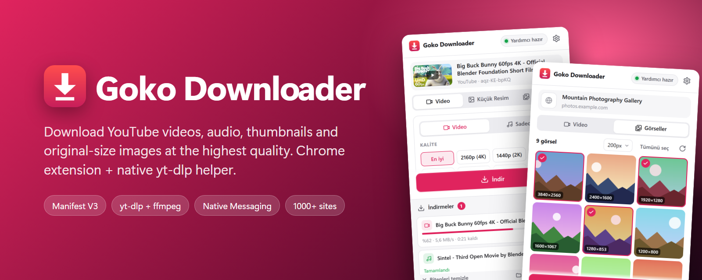
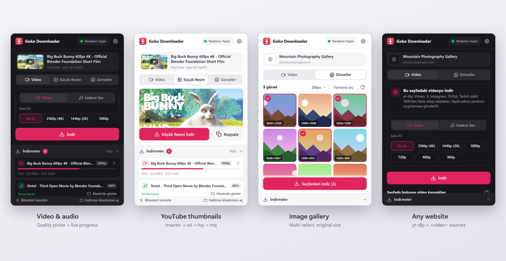
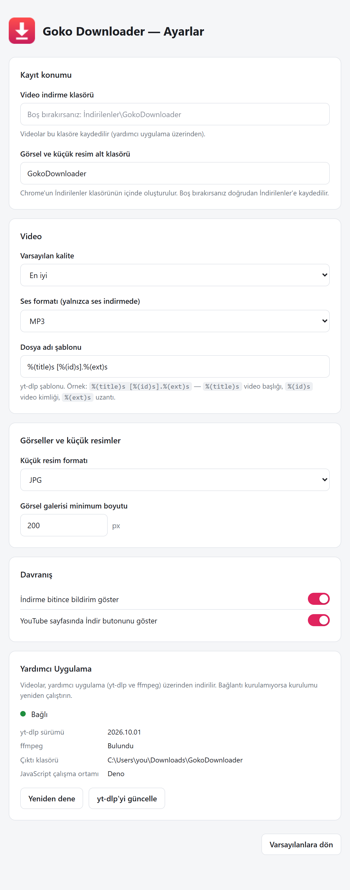
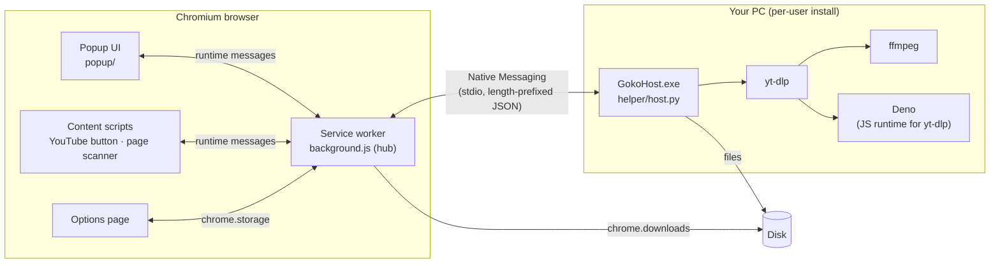
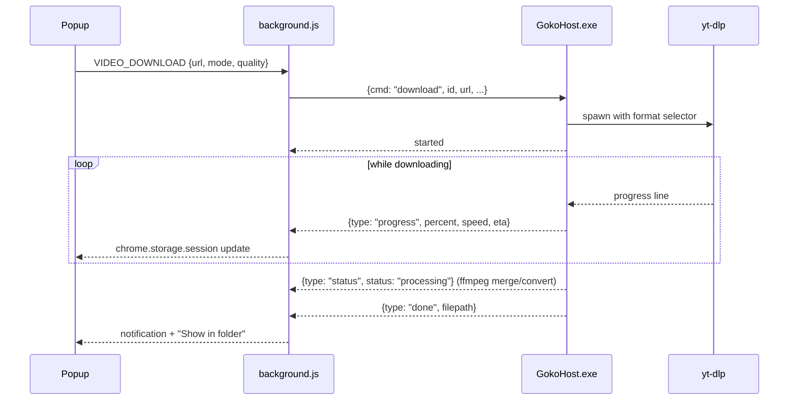

<div align="center">



[](../../releases)
[](extension/manifest.json)
[](#requirements)
[](https://github.com/yt-dlp/yt-dlp)
[](tools/test-resolver.mjs)

**Download videos, audio, thumbnails and original-size images from YouTube and 1000+ other sites, at the highest available quality.**

[Install](#installation) · [Usage](#usage) · [How it works](#how-it-works) · [Development](#development) · [Troubleshooting](#troubleshooting)

</div>

---

Goko Downloader is a two-part tool:

- a **Chrome extension** (Manifest V3, vanilla JS, no build step, no npm dependencies) that provides the UI, context menus, an in-page YouTube button and an image gallery;
- a small **native messaging helper** for Windows (Python, standard library only) that drives [yt-dlp](https://github.com/yt-dlp/yt-dlp) and [ffmpeg](https://ffmpeg.org/) and streams progress back to the browser.

The helper ships with yt-dlp, ffmpeg and Deno inside a per-user installer, so end users don't need to install Python or anything else.

> [!NOTE]
> The extension UI is currently **Turkish only**. Translations are welcome, see [Contributing](#contributing). A [UI glossary](#ui-glossary-turkish--english) is included below.



## Features

| | |
|---|---|
| 🎬 **YouTube video** | Pick 360p → 2160p (4K) or "best". Video and audio streams are merged to MP4 with ffmpeg. |
| 🎵 **Audio only** | Extract MP3 (most compatible) or M4A (original quality). |
| 🌐 **1000+ sites** | The page URL is handed to yt-dlp (Vimeo, X, Instagram, TikTok, Twitch, …). Direct `<video>`, HLS and DASH sources found on the page are listed too. |
| 🖼️ **YouTube thumbnails** | Best available resolution, falling back `maxres → sd → hq → mq`, as JPG or WebP. The 120×90 "not found" placeholder is detected and skipped. |
| 📷 **Any image, original size** | Right-click an image or use the popup gallery. Scans `srcset`, `<picture>`, lazy-load `data-*` attributes and CSS backgrounds, and applies upgrade rules for known CDNs (see [image resolver](#image-resolver)). |
| ⬇️ **In-page button** | An "İndir" (Download) button is injected next to Like/Share on YouTube, with a quality menu. |
| 📊 **Live progress** | Percent, speed, ETA, cancel, retry and "show in folder" in the popup. Desktop notification on completion. |
| 🌗 **Light & dark** | Follows the system theme. |
| 🔒 **Local only** | No servers, no telemetry, no accounts. Everything runs on your machine. |

## Installation

### Requirements

- Windows 10 / 11, x64 (the installer and helper registration are Windows-only for now)
- Google Chrome 116+, or another Chromium browser: **Chrome, Edge and Brave** are registered by the installer

### 1. Install the helper

Download **`GokoDownloaderSetup.exe`** from the [latest release](../../releases/latest) and run it. No administrator rights are needed.

It installs to `%LOCALAPPDATA%\Programs\GokoDownloader` and registers the native messaging host for the current user (`HKCU`) in Chrome, Edge and Brave.

### 2. Load the extension

1. Clone this repo or download it as a ZIP.
2. Open `chrome://extensions` and enable **Developer mode**.
3. Click **Load unpacked** and select the [`extension/`](extension) folder.
4. **Restart the browser** so it picks up the native host registration.

The extension ID is pinned by the `key` field in [`manifest.json`](extension/manifest.json) to `ckhglpifnfloifbggnfbgecaeiaacjbf`. The installer's host manifest only allows that origin, so don't change the key.

> Without the helper, image and thumbnail downloads still work. Video downloads need the helper.

> [!IMPORTANT]
> The extension is intentionally **not** published on the Chrome Web Store because downloading YouTube content violates YouTube's Terms of Service. It is installed unpacked. See [Legal](#legal).

## Usage

- **Popup**: click the toolbar icon. On a YouTube video you get *Video*, *Thumbnail* and *Images* tabs; on other pages *Video* and *Images*. The bottom drawer shows active downloads, helper status, "open folder" and settings.
- **Context menus**:

  | Where | Menu item |
  |---|---|
  | On an image | Download image in highest quality |
  | On a page / video | Download the video on this page (best quality) |
  | On a link | Download the video behind this link |
  | On YouTube | Download YouTube thumbnail (highest quality) |

- **YouTube page button**: the *İndir* menu offers best quality, 1080p, 720p, MP3 or the thumbnail.
- **Settings** (gear icon): output folder, default quality and audio format, [yt-dlp filename template](https://github.com/yt-dlp/yt-dlp#output-template), thumbnail format, notifications, minimum gallery image size, and the page-button toggle.



**Default save locations**

- Videos: `Downloads\GokoDownloader` (configurable; handled by the helper)
- Images and thumbnails: a `GokoDownloader` subfolder inside Chrome's download folder (saved via `chrome.downloads`)

### UI glossary (Turkish → English)

| Turkish | English | Turkish | English |
|---|---|---|---|
| İndir | Download | Yardımcı hazır / yok | Helper ready / missing |
| Video, Sadece Ses | Video, Audio only | Kalite, En iyi | Quality, Best |
| Küçük Resim | Thumbnail | Görseller | Images |
| Seçilenleri indir | Download selected | Tümünü seç | Select all |
| İndirmeler | Downloads | Klasörde göster | Show in folder |
| Tekrar dene | Retry | Ayarlar | Settings |

## How it works



**Video download flow**



Key design points:

- **No build step for the extension.** ES modules in the service worker and popup; content scripts are classic scripts with the few constants they need inlined.
- **State lives in `chrome.storage.session`** (downloads, helper status) and the UI reacts to `chrome.storage.onChanged`, so the popup can close and reopen mid-download.
- **Images and thumbnails never touch the helper.** They are resolved in the service worker (candidates are probed best-first) and saved via `chrome.downloads`.
- **The helper uses only the Python standard library**, is frozen with PyInstaller, and finds `yt-dlp.exe`/`ffmpeg.exe` next to itself.
- The full interface contract (message types, storage keys, native protocol) is in [`docs/CONTRACT.md`](docs/CONTRACT.md).

### Image resolver

[`extension/lib/imageResolver.js`](extension/lib/imageResolver.js) turns whatever the page exposes into an ordered list of candidate URLs (best → worst, deduplicated, absolute) and the service worker downloads the first one that responds. Besides `srcset`/`<picture>`/`data-*`/linked-image heuristics it has site rules for X/Twitter, Wikimedia, Google user content, YouTube, Pinterest, Shopify, WordPress, Fandom, Imgur, Reddit, Unsplash, Cloudinary, Amazon and Bing. New rules are easy to add and covered by [`tools/test-resolver.mjs`](tools/test-resolver.mjs).

### Permissions

| Permission | Why |
|---|---|
| `nativeMessaging` | Talk to the local helper (yt-dlp/ffmpeg). |
| `downloads` | Save images, thumbnails and direct video files. |
| `contextMenus` | Right-click actions. |
| `activeTab`, `scripting`, `tabs` | Scan the current page for images and `<video>` sources; read the tab URL/title. |
| `storage` | Settings (`sync`) and transient download state (`session`). |
| `notifications` | "Download finished/failed" notifications. |
| `host_permissions: <all_urls>` | Fetch and probe image candidates from arbitrary CDNs. |

**Privacy:** the extension has no backend and sends no analytics. For video downloads the page URL is passed to the local yt-dlp process, which contacts the site you are downloading from. Helper logs stay in `%LOCALAPPDATA%\GokoDownloader\host.log`.

## Development

### Repository layout

| Path | Contents |
|---|---|
| [`extension/`](extension) | Chrome extension: `manifest.json`, `background.js`, `popup/`, `options/`, `content/`, `lib/`, `icons/` |
| [`helper/`](helper) | Native messaging host (`host.py`, `host.spec`). `vendor/` and `dist/` are build outputs (git-ignored) |
| [`installer/`](installer) | Inno Setup script `GokoDownloader.iss`; output goes to `installer/output/` (git-ignored) |
| [`tools/`](tools) | Tests, key tooling, icon generator, dev registration, vendor fetcher |
| [`docs/CONTRACT.md`](docs/CONTRACT.md) | Interface contract between all components |
| [`build.ps1`](build.ps1) | One-shot build of helper + installer |

### Run from source (no installer)

```powershell
# 1. Download yt-dlp, ffmpeg and deno into helper/vendor/
powershell -ExecutionPolicy Bypass -File tools/fetch-vendor.ps1

# 2. Register helper/host.py as the native host (no exe build needed)
powershell -ExecutionPolicy Bypass -File tools/register-dev.ps1

# 3. Load extension/ unpacked in chrome://extensions, restart the browser
```

Remove the dev registration with `tools/register-dev.ps1 -Remove`.

### Tests

```powershell
node tools/test-resolver.mjs                         # image/URL resolver + YouTube helpers (72 checks)
py tools/test-host.py                                # native host protocol smoke test
py tools/test-host.py --download <URL>               # real download through the host
```

### Build the installer

Prerequisites: Python 3 + PyInstaller, Node.js, [Inno Setup 6](https://jrsoftware.org/isinfo.php) (`winget install JRSoftware.InnoSetup`).

```powershell
powershell -ExecutionPolicy Bypass -File build.ps1
# -> installer/output/GokoDownloaderSetup.exe
```

`build.ps1` fetches the vendor binaries, computes the extension ID from the manifest `key`, freezes the helper with PyInstaller (`helper/dist/GokoHost/`), then runs Inno Setup. Use `-SkipVendor` / `-SkipPyInstaller` to reuse earlier outputs.

> [!WARNING]
> `tools/extension-key.pem` is the **private key** that pins the extension ID. It is git-ignored; keep it private and back it up. If it is lost the ID changes and every installed helper registration stops matching. `node tools/gen-key.mjs` regenerates the manifest `key` from it.

## Troubleshooting

- **Popup shows "Yardımcı yok" (helper missing)**
  1. Make sure `GokoDownloaderSetup.exe` finished installing.
  2. Fully quit and restart the browser.
  3. Check on `chrome://extensions` that the extension ID is `ckhglpifnfloifbggnfbgecaeiaacjbf`. A different ID won't match `allowed_origins` in the host manifest.
- **YouTube download fails**: YouTube changes often, so keep yt-dlp current. Use the **yt-dlp güncelle** (update yt-dlp) button in the popup or settings, then retry.
- **Logs**: `%LOCALAPPDATA%\GokoDownloader\host.log`. Please attach the relevant lines when reporting a bug.
- **Uninstall**: remove "Goko Downloader" in *Windows Settings → Apps*. This deletes the helper, its registry keys and the log folder. Then remove the extension from `chrome://extensions`.

## Contributing

Issues and PRs are welcome. Ideas that would help most:

- **Localization**: strings are currently hardcoded in Turkish; moving them to `chrome.i18n` (`_locales/`) would unlock English and other languages.
- **macOS / Linux helper**: `host.py` is stdlib-only and mostly portable; packaging and native-host registration for other platforms are missing.
- **More image-resolver rules** for sites that serve downscaled images (add a test case in `tools/test-resolver.mjs`).

Before opening a PR, run `node tools/test-resolver.mjs` and keep to the conventions in [`docs/CONTRACT.md`](docs/CONTRACT.md).

## Legal

For personal use only. You are responsible for complying with the copyright of what you download and with the terms of service of the sites you use, including YouTube's. Downloading YouTube content is against YouTube's Terms of Service, which is why this extension is not distributed through the Chrome Web Store.

Goko Downloader bundles and invokes third-party tools under their own licenses: [yt-dlp](https://github.com/yt-dlp/yt-dlp) (Unlicense), [FFmpeg](https://ffmpeg.org/legal.html) (essentials build from gyan.dev) and [Deno](https://github.com/denoland/deno) (MIT). This project is not affiliated with or endorsed by YouTube or Google.

The sample video in the screenshots is *Big Buck Bunny* © Blender Foundation, [CC BY 3.0](https://peach.blender.org/about/).
